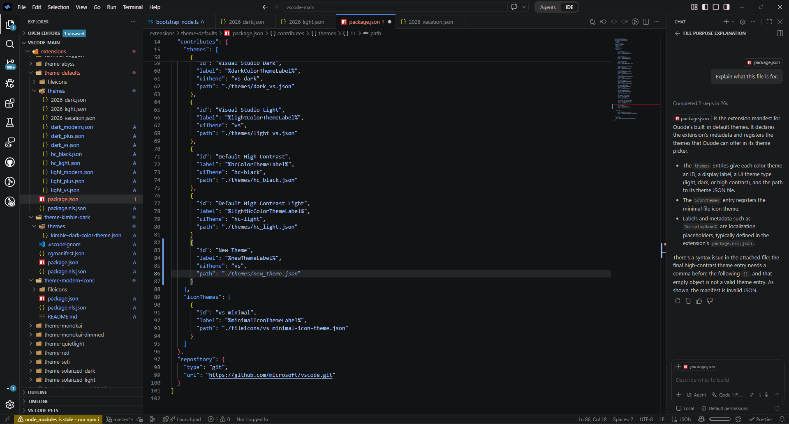

# Quode

Hi, Welcome to Quode!

[]

Quode is a vscode-fork code editor that allows you to:

 - Create sandbox (for any AI agent or for yourself)
 - Auto changes recorder (records all your changes)
 - And More!

 What Quode has developed:
 - Quode CLI
 - Quode Web
 - Quode IDE (without the Agent Panel)
 - Quode Agent

If you are interested to help Quode team. You can contribute by sponsering!

**NOTE**: Quode is not fully made or fully public yet. So no one can download quode right now.
